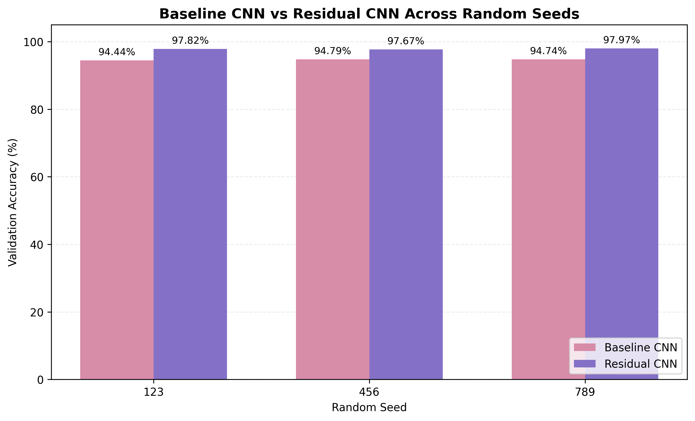
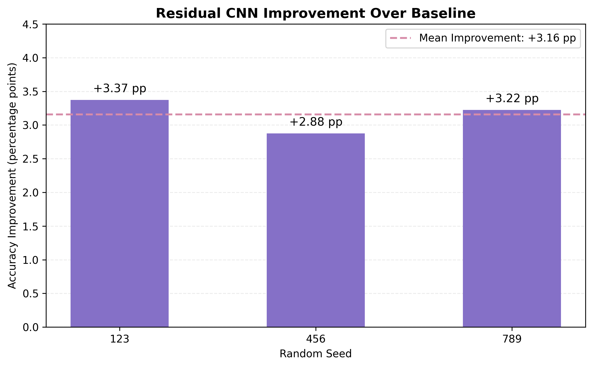
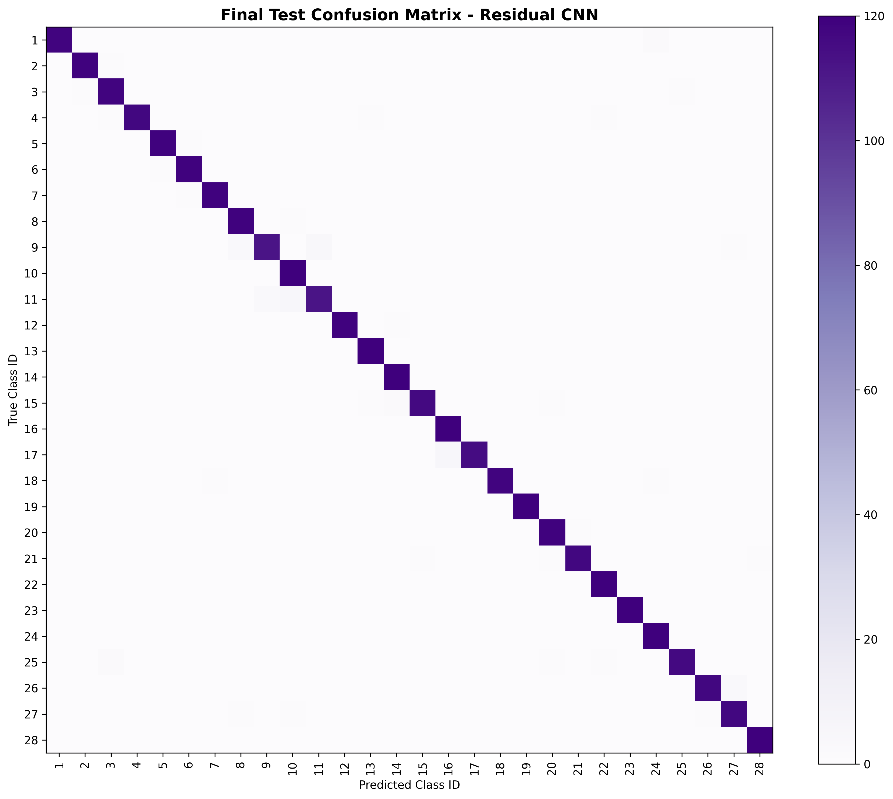
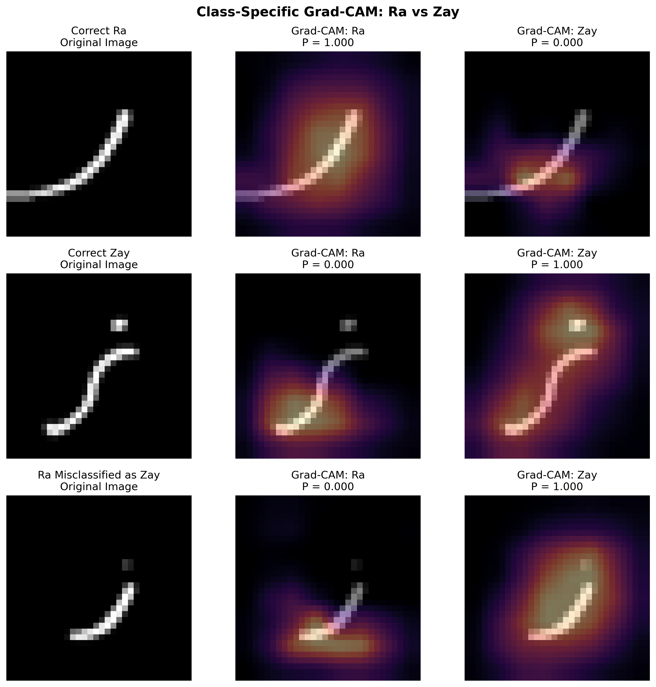

<div align="center">

# Arabic Handwritten Character Recognition

### From CNN experiments to an interactive Arabic letter recognition application

**Deep Learning · Computer Vision · TensorFlow / Keras · Explainable AI · Gradio**

**28 Arabic letters** · **3 random seeds** · **98.39% held-out test accuracy**

*اللغةُ العربيةُ هُوِيَّةٌ وبيان، وفلسطينُ حُرَّةٌ في القلبِ والوجدان* 🇵🇸

</div>

---

## Overview

This project investigates recognition of isolated handwritten Arabic characters using convolutional neural networks (CNNs). It goes beyond training a single classifier by exploring data quality, augmentation, controlled multi-seed experiments, residual architectures, error analysis, and Grad-CAM explanations.

The selected model is deployed in a **Gradio application** featuring a Palestine-inspired interface. Users can **draw a character with a thin brush** or **upload a character image** to receive a prediction, the top three class scores, and the actual preprocessed 32 × 32 input.

> **Status:** The application source and trained model are included in this repository. A permanently hosted public demo is **not yet available**. Results on images drawn or uploaded by users may differ from the AHCD benchmark.

## Highlights

| Item | Result |
|:--|:--|
| Task | 28-class isolated handwritten Arabic character recognition |
| Dataset | Arabic Handwritten Characters Dataset (AHCD) |
| Selected model | Residual CNN, random seed 789 |
| Model size | 230,780 parameters |
| Final held-out test set | 3,360 images |
| **Test accuracy** | **98.3929%** (3,306 / 3,360 correct) |
| **Test macro-F1** | **98.3896%** |
| **Test top-3 accuracy** | **99.8810%** |
| Test errors | 54 |

**Important:** These final test results refer to **one preselected model (seed 789)**, chosen using validation results. The test data were not used to choose the model or its hyperparameters.

## Dataset and preparation

The project uses the [Arabic Handwritten Characters Dataset (AHCD)](https://github.com/mloey/Arabic-Handwritten-Characters-Dataset), consisting of grayscale character images at **32 × 32** resolution.

| Stage | Images |
|:--|--:|
| Original AHCD training partition | 13,440 |
| Removed blank training sample | 1 |
| Cleaned training partition | 13,439 |
| Model training split | 11,423 |
| Validation split | 2,016 |
| Held-out AHCD test partition | 3,360 |

The preprocessing pipeline verifies image orientation, removes the single fully black training sample, splits the cleaned training partition with stratification, normalizes pixel intensities to **[0, 1]**, and encodes the **28 classes** as indices **0–27**. The model expects **light-colored strokes on a dark background**.

The original AHCD dataset is **not redistributed in this repository**. Refer to its original source for access and applicable terms.

## Experimental design

The notebook documents these experiments:

1. **Data quality and exploratory analysis:** pixel distributions, class balance, anomalous samples, duplicates, and visual similarity.
2. **Baseline CNN:** a compact classifier with **103,420 parameters**.
3. **Augmentation study:** standard and light augmentation configurations compared with the baseline.
4. **Multi-seed study:** experiments using random seeds **123, 456, and 789**.
5. **Residual CNN:** an enhanced architecture with **230,780 parameters**.
6. **Explainable AI:** class-specific Grad-CAM visualizations, including the confusion between **ر** and **ز**.
7. **Final evaluation:** a single held-out test evaluation for the validation-selected model.
8. **Application:** Gradio drawing and upload workflows with preprocessing and top-3 outputs.

### Baseline versus Residual CNN — validation

All results below use the **same 2,016 validation images** for each model; variability across seeds is reported as the **sample standard deviation**.

| Seed | Baseline accuracy | Residual accuracy | Improvement |
|:--:|--:|--:|--:|
| 123 | 94.4444% | 97.8175% | +3.3730 pp |
| 456 | 94.7917% | 97.6687% | +2.8770 pp |
| 789 | 94.7421% | 97.9663% | +3.2242 pp |
| **Mean ± SD** | **94.6594 ± 0.1878%** | **97.8175 ± 0.1488%** | **+3.1581 ± 0.2545 pp** |

These results show a consistent advantage for the **tested Residual CNN architecture** across three seeds. They do **not** establish that skip connections alone caused the improvement: the residual architecture has more than twice as many parameters, and three runs are insufficient for strong statistical-significance claims.





### Final test evaluation

The model selected on validation performance (**Residual CNN, seed 789**) achieved **98.3929% accuracy** on the separate AHCD test set, with **54 errors out of 3,360 images**.



Some challenging character pairs include **ظ → ط**, **ز → ر**, and **ذ → ز**. For the full results, see [`results/tables/`](results/tables/).

### Grad-CAM: interpreting model predictions

Class-specific Grad-CAM heatmaps help inspect regions associated with classification scores. The notebook illustrates a confusing **ر / ز** validation example; these maps are **approximate interpretability tools**, not pixel-level causal explanations.



## Interactive application

The application supports:

- **Drawing** an Arabic letter with a mouse or touch input (**thin brush recommended**).
- **Uploading** a single handwritten character image (no webcam needed).
- Displaying the **predicted letter**, **top-three model scores**, and **32 × 32 preprocessed image**.
- A **Palestine-inspired visual theme** and the original Arabic phrase displayed after recognition:

> **اللغةُ العربيةُ هُوِيَّةٌ وبيان، وفلسطينُ حُرَّةٌ في القلبِ والوجدان**

### Run the app locally

Use a Python version compatible with the dependencies in [`app/requirements.txt`](app/requirements.txt). From the repository root:

```bash
cd app
python -m pip install -r requirements.txt
python app.py
```

Open the local URL printed by Gradio. Inference is designed to run on **CPU**; a GPU is **not required** to use the application.

> **Input-domain caution:** The reported 98.39% accuracy is on AHCD's held-out test partition, not on arbitrary handwriting. In manual tests, **thinner strokes** worked better than thick strokes; calligraphic, large, or stylistically different uploaded images may be misclassified. A high softmax score does not necessarily mean a well-calibrated probability.

## Repository structure

```text
Arabic-Handwritten-Character-Recognition/
├── app/
│   ├── app.py                         # Gradio interface
│   ├── arabic_residual_cnn.keras      # Selected trained CNN
│   ├── preprocessing.py               # Input preprocessing
│   ├── class_labels.json             # Class index → Arabic letter
│   ├── model_config.json             # Model configuration
│   ├── requirements.txt               # App dependencies
│   └── README.md                      # Deployment-specific metadata
├── notebooks/
│   └── Arabic_Handwritten_Character_Recognition.ipynb
├── results/
│   ├── figures/                       # Experiment and Grad-CAM plots
│   └── tables/                        # CSV results and metrics
├── .gitignore
└── README.md
```

### Notebook reproducibility

The [experimental notebook](notebooks/Arabic_Handwritten_Character_Recognition.ipynb) documents the full development process. It was prepared for GitHub by clearing execution outputs while preserving the experiment code and explanatory cells.

**The notebook is a research record, not a one-click script.** Some cells refer to Google Colab, Google Drive paths, saved checkpoints, and earlier stages of the workflow. To reproduce the study, obtain AHCD separately, run the sections in order, and update the Drive/data paths for your environment. Avoid running all training cells blindly: training is computationally expensive and some cells were used for experiment recovery.

## Limitations and responsible interpretation

- **Validation splitting:** stratification was used, but independent writer-group separation for the validation split was **not verified**.
- **Architecture comparison:** the models differ in both design and parameter count; the experiment does not isolate the effect of residual connections.
- **Number of seeds:** three repetitions provide a descriptive robustness check, not a large-sample statistical conclusion.
- **Explainability:** Grad-CAM approximates spatial influence; it is not proof of how a particular stroke caused the prediction.
- **Deployment:** upload/drawing inputs can differ substantially from AHCD's data distribution, especially with different stroke thickness, background, layout, and calligraphic style.
- **Hosting:** the repository includes application source code, but a stable public hosted deployment is **pending**.

## Tools

**Python**, **TensorFlow / Keras**, **NumPy**, **Pandas**, **scikit-learn**, **Matplotlib**, **Pillow**, **Gradio**, **Google Colab**, and **Git / GitHub**.

## Reference and attribution

- **Dataset:** [Arabic Handwritten Characters Dataset (AHCD)](https://github.com/mloey/Arabic-Handwritten-Characters-Dataset) by the dataset's original contributors. Refer to the original repository and related publication for citation and usage conditions.
- **Project status:** educational/research demonstration; model performance claims are limited to the recorded evaluations.

---

<div align="center">

**Arabic handwriting · Deep learning · Cultural heritage**

*اللغةُ العربيةُ هُوِيَّةٌ وبيان، وفلسطينُ حُرَّةٌ في القلبِ والوجدان* 🇵🇸

</div>
